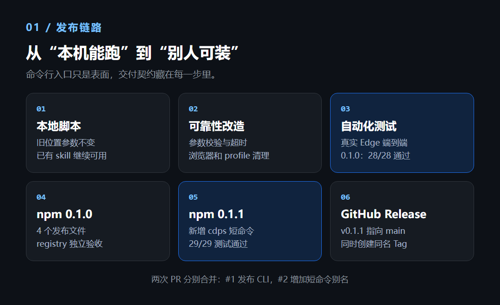
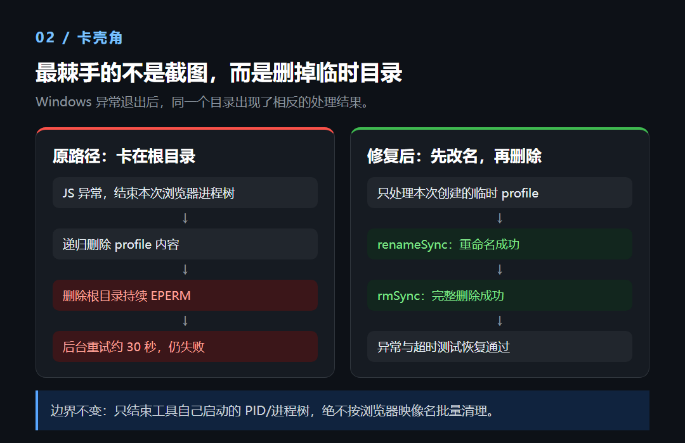
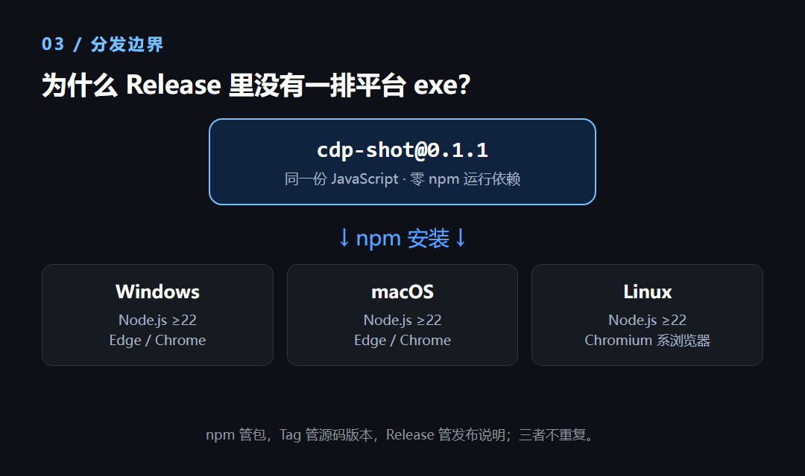

> A 系 AI 工作流第 6 篇。这次不处理视频和字幕，拆一个更小的工具：叶扬日常用来给知识卡片、博客页面和 DOM 元素截图的 `cdp-shot`。

一个网页截图脚本已经在本地用了很久，把它发到 npm，理论上只剩 `npm publish` 一步。真正做下来，最花时间的是另一件事：截图失败以后，临时浏览器目录能不能收干净。

`cdp-shot@0.1.1` 的发布包只有 4 个文件，29 项测试通过，保留 `cdp-shot` 和 `cdps` 两个命令。包很小，交付过程却不只是写一个 `bin` 字段。



## 先保住原来的调用方式

这个脚本直接走 Chrome DevTools Protocol，简称 CDP。大白话讲，就是浏览器自己留了一条调试通道，Node.js 通过它让 Edge 或 Chrome 打开网页、执行 JavaScript、截下指定区域。

叶扬没有为了发包改成 Playwright 或 Puppeteer。原来的 CDP 主链路已经能用，换框架不会自动解决 Windows 清理、参数兼容和发布验收，反而会把已验证的部分重新洗牌。

首版因此定了几条很具体的约束：

| 约束 | 实际做法 |
|---|---|
| 旧脚本继续可用 | 仓库里的 `node cdp-shot.js ...` 调用不删 |
| 新命令不逼用户改习惯 | 首版提供 `cdp-shot`；后续新增 `cdps` 时也保留旧入口 |
| 不扩大运行依赖 | Node.js ≥22，零 npm 运行依赖，复用本机 Chromium 系浏览器 |
| 不夹带工作区文件 | `files` 白名单只放行 `cdp-shot.js` |

最后一条要实际解包检查。npm 会自动带上 `package.json`、README 和 LICENSE，加上白名单里的脚本，发布 tarball 正好 4 个文件。skill 手册、测试 fixture、PowerShell 脚本、浏览器 profile 和登录态都不在里面。

这里说的 tarball，是用户真正从 npm 下载的压缩包。源码仓库里有什么，不等于用户会装到什么。

## Windows 上，删目录比截图更难

发布前的异常测试暴露了一个很反直觉的问题：浏览器进程树已经结束，递归删除也执行了，临时 profile 的根目录仍持续报 `EPERM`，后台重试约 30 秒也没删掉。

叶扬没有继续加码杀进程，而是对同一个目录做了三步对照：

1. 直接 `rmSync`，根目录持续报权限错误；
2. 先 `renameSync`，改名成功；
3. 删除改名后的目录，完整删除成功。



修复落在异常和超时路径：先把本次创建的临时目录改成唯一的待删除名，再重试删除。它不是 Windows 权限问题的万能药，只适用于工具自己创建的独立临时目录，并依赖同一磁盘内改名。

还有一条边界没有为清理让路：只结束工具自己启动的 PID 和进程树，不按 `msedge.exe`、`chrome.exe` 的映像名批量清扫。否则截一张图，顺便把用户正在用的浏览器全关了，问题就比残留目录严重得多。

## 本地全绿之后，再从 npm 装一次

`0.1.0` 的 28 项测试覆盖了普通截图、整页、元素取景、CSS 替换、点击、暗色和持久 profile 等行为。发布前还实际打过 tarball、解包运行；发布后再用独立缓存从 registry 执行 `npx`，验证公开产物。

新增短命令后，`0.1.1` 补到 29 项测试，两个入口都验证了版本输出和真实截图：

| 版本 | 变化 | 自动化结果 |
|---|---|---:|
| 0.1.0 | 首个公开 CLI，保留旧位置参数 | 28/28 |
| 0.1.1 | 新增 `cdps`，保留 `cdp-shot` | 29/29 |

免全局安装时，包名和命令名要写清楚。`cdps` 是包里的命令，不是另一个 npm 包：

```bash
npx --yes --package=cdp-shot@0.1.1 cdps \
  https://example.com out.png 1440 900 --scale 1
```

需要整页、手机视口或暗色模式时，继续加参数：

```bash
cdps https://example.com full.png 1440 900 --full --scale 1
cdps https://example.com mobile.png 390 844 --scheme dark
```

测试全绿只说明写下来的契约没有退化，发布后的独立安装则回答了另一个问题：用户拿到的那只包，是否真的含有能运行的入口。

## 为什么 Release 里没有一排 exe

npm 包、Git Tag 和 GitHub Release 这次都保留了，但三者没有互相替代。npm 分发实际运行产物，Tag 标记源码版本点，Release 放发布说明和源码归档。



`cdp-shot` 交付的是同一份 JavaScript，不编译各平台可执行文件。用户本机提供 Node.js ≥22 和 Edge、Chrome 或其他兼容浏览器即可。只有目标变成“不装 Node.js，下载一个文件就跑”，才需要引入多平台构建、签名和维护成本。

所以，`0.1.1` 的完成标准不是“脚本能截图”，而是旧调用没断、失败知道怎么收尾、包内文件数得清、线上版本装回来还能跑。剩下那些没有覆盖的浏览器和平台差异，不靠这 29 项测试替它们打包票。

项目地址：

- npm：[cdp-shot](https://www.npmjs.com/package/cdp-shot)
- GitHub：[claude-skill-screenshot](https://github.com/yeyangchen2009/claude-skill-screenshot)
- Release：[v0.1.1](https://github.com/yeyangchen2009/claude-skill-screenshot/releases/tag/v0.1.1)
