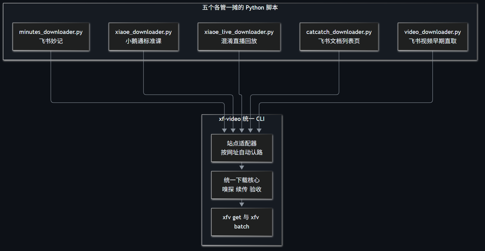
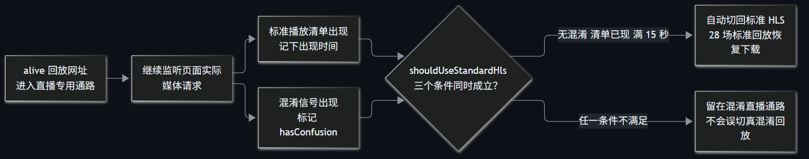

> A 系 AI 工作流第 7 篇。前面几篇处理字幕和发布流程，这篇把镜头对准下载工具本身：五个各管一摊的 Python 脚本，怎样收敛成 `xfv`，又怎样被真实故障推到 `0.1.2`。

`xf-video@0.1.0` 发布时有 53 项测试全绿。当天第一次按真实用户的方式跑 `login`，终端直接报出：

```text
TypeError: parseHttpUrl is not a function
```

函数明明写在源码里，问题只在文件底部漏了一行导出。修复代码很短，真正值得复盘的是：为什么测试没拦住，以及后面的 28 场回放失败又怎样补进产品。

## 五个脚本先共用一个入口，不假装只有一种视频

合并之前，叶扬手上有五个 Python 脚本：小鹅通标准课、混淆直播回放、飞书妙记各一个，飞书文档列表页和早期视频直取又各一个。它们共享浏览器登录、媒体嗅探、FFmpeg 搬运和文件验收，却各自维护一套参数和收尾。

`xf-video` 把重复部分收进统一下载核心，把不同站点留在适配器里。适配器负责认出网址和媒体形态，核心负责下载、重试、临时文件与验收。下载主流程对外收成 `xfv get` 和 `xfv batch`，另保留 `login` 与 `doctor`。



基本用法只剩下：

```bash
npm install -g xf-video
xfv doctor
xfv login "课程页面链接"
xfv get "视频页面链接" -o "课程.mp4"
```

工具只下载本人已获授权的内容，不做 DRM、验证码、权限或风控绕过。统一入口解决的是重复维护，不是把平台边界抹掉。

## 53 项测试保护不到没写进去的 login

`parseHttpUrl` 的函数体没有坏。CommonJS 文件里的函数要交给别的模块使用，必须登记在 `module.exports` 中；首版漏了这个名字，调用方拿到的就是 `undefined`。

补上导出只要一行，`0.1.1` 却多补了一项 login 测试。先用非法链接验证参数错误返回退出码 2，再用替身浏览器验证合法链接会进入登录链路并返回 0。新测试先在旧代码上失败，再由修复把它变绿，测试总数从 53 增到 54。

登录需要本人扫码，并不意味着整个命令都无法自动测。链接校验和调用编排可以交给机器，只有真实扫码留给人。首版把这两层混在了一起，缺口恰好从那里进来。

## 同一个 alive 路径，里面其实有两种回放

`0.1.2` 面对的是一个更具体的现场：29 场直播回放批量归档，28 场超时。旧逻辑只要看见 `/v4/course/alive/`，就进入直播专用通路，等待 `confusion_index` 混淆信号。

这 28 场虽然门牌相同，实际发的却是标准 HLS 播放清单。HLS 可以先把视频理解成按清单加载的一串切片；页面根本没有混淆信号，旧通路只能一直等。

新版本继续监听真实网络请求，把回退判断抽成 `shouldUseStandardHls`。只有三个条件同时成立才切回标准 HLS：没有出现混淆信号、标准清单已经出现、15 秒宽限期已满。带 `confusion_index` 的网址还做了显式排除。



修完后，28 场标准回放恢复下载；一场 49.06 分钟、968,504,696 字节的样本通过整段解码。路由回退补了专项测试，连同后面的进度与访问检测，`0.1.2` 一共 63 项测试。

15 秒是这次实现选取的宽限期，不是平台协议保证。真实样本和条件组合测试能证明已覆盖的路径，不能替以后所有页面形态打包票，所以支持矩阵仍把混淆型回放的样本情况单列。

## 下载成功，体验也可能不合格

路由修好后，叶扬又跑了一场 99.4 分钟的标准课，文件 461,844,894 字节。文件最终验收通过，终端却长时间没有输出，分不清是在下载还是已经僵死。

`0.1.2` 给 FFmpeg 接上 `-progress`，默认每 5 秒报告一次已处理时长和速度，正常结束时强制收尾。它只汇报已经发生的事实，不预测“还剩几分钟”。

同一版本还改了授权报错。以前页面跳去商品详情，工具只会说没有嗅探到媒体；现在路径出现 `goods_detail` 或正文出现“前往购买”，就提示当前账号无权限或登录态过期，并给出登录、购买的下一步。门关上了不硬闯，但至少别只留一句天书。

这些改动可以按故障而不是按版本号来记：

| 真实现场 | 改动 | 仍保留的边界 |
|---|---|---|
| 首发 login 崩溃 | 补导出与命令测试 | 真人扫码不进自动化 |
| 28 场 alive 回放超时 | 三条件回退标准 HLS | 更多混淆样本仍待验收 |
| 99.4 分钟下载零输出 | 5 秒进度心跳 | 速度字段双空格留待后续修整 |
| 商品页被当成无媒体 | 识别访问拦截并改写报错 | 不提供权限绕过 |

## 签名地址不进 FFmpeg 参数，也不进日志

下载链路里还有一类不能靠肉眼验收的问题：带鉴权的媒体地址会经过浏览器、Node.js 和 FFmpeg，任何一层把完整地址打印出来，都可能把临时凭证留在日志里。

`xf-video` 的 HLS 下载通过只监听 `127.0.0.1` 随机端口的本机代理转发。FFmpeg 只拿到带 32 字节随机令牌的本机地址，真实签名地址保存在进程内存的映射中；同源请求保留必要鉴权，跨域跳转重算请求头并剥离凭证。日志再统一清理媒体签名、鉴权头和本机代理令牌。

这套设计保护的是本机进程间传参和日志边界，不等于匿名，也不改变服务端权限。登录 profile、媒体签名和下载文件仍是敏感数据，不该被分享或提交。

## 0.1.2 的完成度，按验收记录说

飞书妙记 MP4 已完成 538,519,978 字节授权样本的端到端验收；小鹅通标准课和上述标准 HLS 回放有真实样本；混淆型回放有固定向量测试和一次旧样本验证，第二个授权样本仍待补。真实飞书 HLS、更多列表页通路也没有被写成“全部支持”。

从 `0.1.0` 到 `0.1.2`，版本不是靠排期往前推的。login 的导出缺口、alive 的路由误判、长任务的信息真空和授权页的天书报错，各自留下了一项改动和一组测试。包现在的能力有边界，故障也有记录，这比“53 项全绿”更接近真实交付状态。

项目地址：

- npm：[xf-video](https://www.npmjs.com/package/xf-video)
- GitHub：[xf-video](https://github.com/yeyangchen2009/xf-video)
