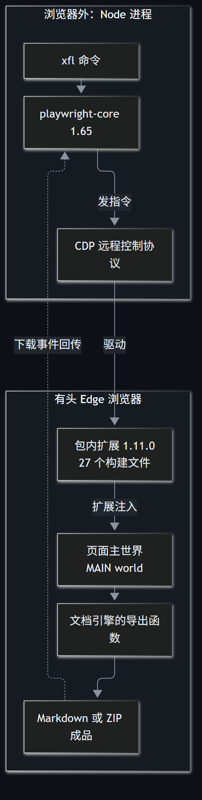
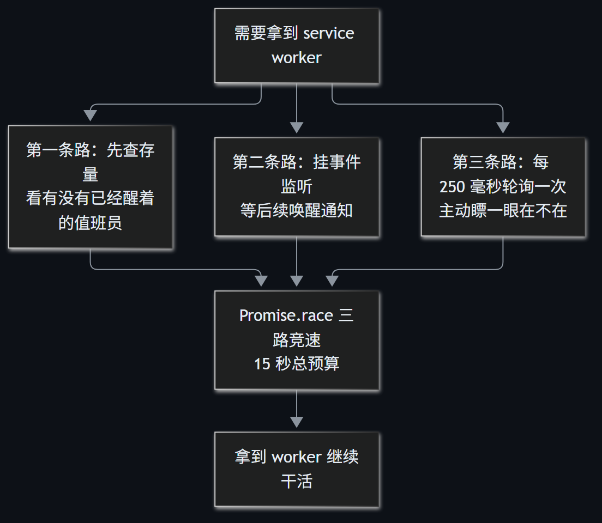

> A 系 AI 工作流第 8 篇。这篇接着聊工具产品化，但问题从视频换到了飞书云文档：一个 299 行的 Python 下载脚本，重写成 `xf-lark` 时，真正难处理的是浏览器时序和失败收尾。

有一次下载过程中，CDP 调用僵住了。终端没有报错，也没有成品，进程裸挂了约 25 分钟。

CDP 是浏览器远程控制协议，Node.js 靠它驱动 Edge。平时点击、读取、保存都很顺，一旦某次调用没有回应，没有超时预算的 `await` 就会一直等下去。`xf-lark` 后来的看门狗，就是从这个现场长出来的。

## 299 行 Python，不能只做语法翻译

旧脚本能把本人有权访问的飞书文档下载成 Markdown 或 ZIP，依靠的不是一个公开下载接口，而是 Cloud Document Converter 浏览器扩展。

扩展进入页面自己的 MAIN world，也就是页面脚本实际运行的环境，再调用文档引擎已有的导出函数。Node.js 负责启动有头 Edge、装载扩展、接收下载事件和验收文件，不能绕过扩展直接替代文档引擎。



`xf-lark@0.1.1` 因此把扩展 `1.11.0` 的 27 个构建文件随包固定分发，并附第三方说明。这样做减少了对用户浏览器里“恰好装过哪个版本”的依赖，也把页面和扩展之间的兼容关系变成了项目自己要维护的契约。

基本命令是：

```bash
npm install -g xf-lark
xfl doctor
xfl login "<飞书文档链接>"
xfl get "<飞书文档链接>"
```

只下载本人已有权限的文档，登录由本人在弹出的 Edge 中完成，不处理密码和验证码。

## 三种看起来等价，实际并不等价的写法

跨语言迁移最先暴露的是执行模型差异。Python 里顺次执行的调用，到了 Node.js 里可能返回 Promise；浏览器自动化库的 API 形态也不同。

| 迁移点 | 出错写法或旧假设 | 实际处理 |
|---|---|---|
| 启动持久浏览器 | 漏掉 `launchPersistentContext` 前的 `await` | 等浏览器上下文真正建立后再继续 |
| 取第一个定位器 | 把 `.first()` 当属性 | Node API 中它是方法，必须调用 |
| 等页面稳定 | 等 `networkidle` | 页面长轮询让网络难有空闲，改为每 2 秒查一次按钮，最多 25 次 |

这些不是 JavaScript 语法难点，而是“什么时候才算准备好”的判断。尤其 `networkidle`，在普通静态页面上很好用，放到持续长轮询的文档页上，等来的往往是超时。

## service worker 可能比你先醒来

Manifest V3 扩展的后台逻辑跑在 service worker 里。可以把它理解成按需唤醒的后台工作者：代码开始监听时，它可能已经注册并出现在浏览器上下文中；后挂的事件监听只负责后续注册，补取不到已经存在的对象。

只等事件，会错过已经发生的那一次；只查当前列表，又可能查得太早。`xf-lark` 最后让三条路一起跑：



先查有没有已经存在的 worker，同时挂事件监听，再每 250 毫秒主动轮询一次。三路进入 `Promise.race`，谁先给出有效结果就用谁，总预算 15 秒。

这里的重点不是 `Promise.race` 这个 API，而是不再赌一种时序。浏览器事件的先后顺序不受脚本作者控制，等待逻辑必须同时容纳“已经发生”和“稍后发生”。

## 看门狗要守住下载，也要守住收尾

那次 25 分钟裸挂之后，跨浏览器、跨网络的等待开始逐项补预算。导航和点击有 30 秒上限，关闭有 10 秒上限；下载保存不再是单独等 `saveAs`，而是让保存结果、超时和中断信号一起竞速。

超时的意义不是保证任务在几十秒内完成，而是失败时能把控制权拿回来。批量任务还要据此清理当前项、记录失败并继续后续条目，而不是让整批任务陪着一个僵死页面等下去。

文件收尾同样按失败路径设计：

1. 浏览器产物先写同目录临时文件；
2. ZIP 检查 `PK` 文件头和 EOCD 尾部目录，Markdown 检查 UTF-8 解码；
3. 校验通过才原子改名成正式文件；
4. 失败时清掉临时文件，不让坏文件占位后被下一批误跳过。

Windows 的真实 Ctrl+C 还有一个平台限制：控制台可能在 Node.js 异步收尾完成前回收进程，临时 profile 不一定来得及删。`xf-lark` 因此没有把所有希望押在退出钩子上，每次启动还会清扫同前缀、超过 1 小时未变动的 `xfl-profile-` 残留，正在运行的新目录不受影响。

## 验收不只看进程退出码

默认测试入口有 61 项纯逻辑与编排测试通过，另有 3 项真实 Edge 门禁单列，共 64 项。`npm pack --dry-run` 核对出 45 个发布文件，其中 27 个是固定版本的扩展构建文件，测试和真实登录态不进包。

更有说服力的是三份真实文档与 Python 版产物的逐项对照：

| 文档 | Node 版字节 | Python 版字节 | 差值 | ZIP 条目 |
|---|---:|---:|---:|---:|
| Agent Skills 锤炼营实战手册 | 35,581,933 | 35,581,937 | 4 | 127 |
| AI Agent 锻造师实战手册 | 57,206,713 | 57,206,714 | 1 | 176 |
| Workbuddy 铸造营实战手册 | 44,224,723 | 44,224,722 | 1 | 158 |

三份文档的 ZIP 条目数一致，1 到 4 字节差异来自 ZIP 元数据时间戳，内容等价。旧目录结构、命名截断和同名 SKIP 也刻意对齐，老输出目录可以接着重跑。

还没有拿到的样本则单独记账：无图纯文本文档的真实端到端样本仍待补，严格 Markdown 解码分支目前靠单元测试和本地仿造链路覆盖。`0.1.1` 本身只统一了对外“飞书”文案，没有增加下载功能。

从 299 行 Python 到公开 npm 命令，代码行数并没有说明难度。真正决定工具能不能交出去的是那些不太显眼的地方：事件早到了怎么办，浏览器不回话怎么办，文件只写了一半怎么办。把这些路径补齐以后，`xfl` 才算从“能导出”走到了“知道怎样失败”。

项目地址：

- npm：[xf-lark](https://www.npmjs.com/package/xf-lark)
- GitHub：[xf-lark](https://github.com/yeyangchen2009/xf-lark)
