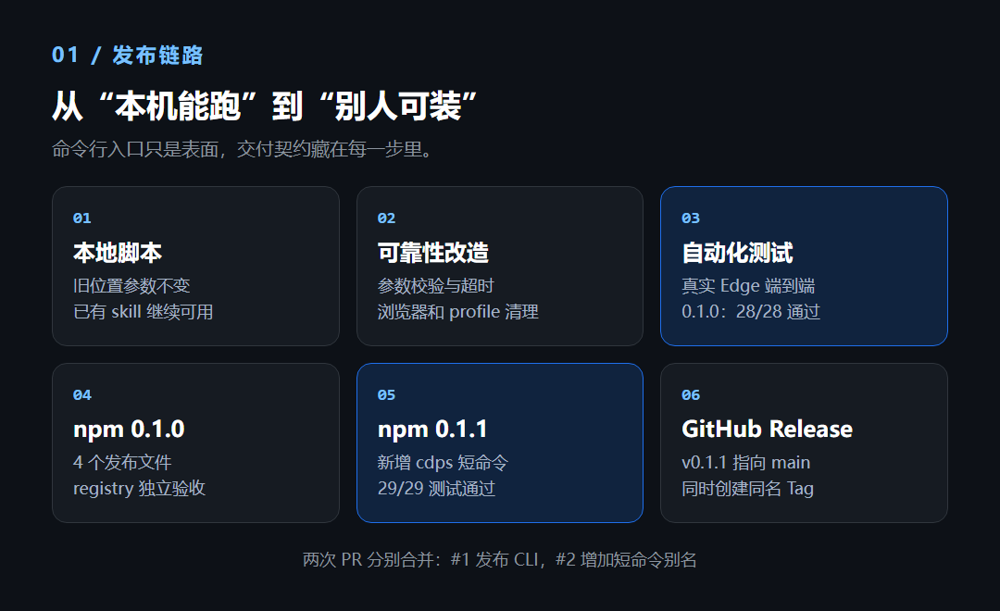
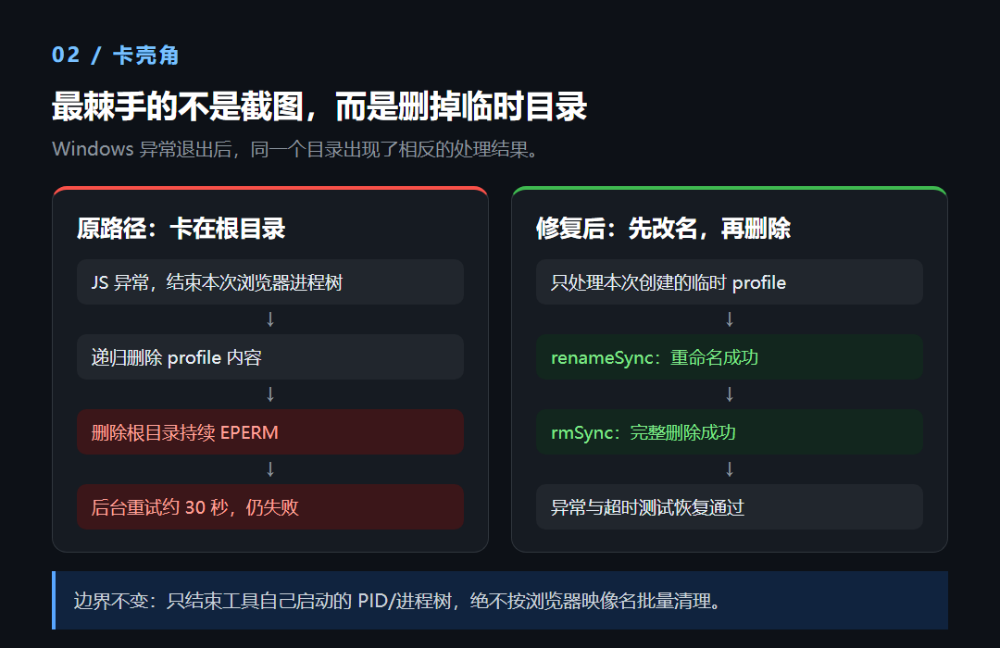

> A 系 AI 工作流第 9 篇。[A06](/post/205.html) 讲的是 `cdp-shot` 怎样发布成 npm 包，这篇换成使用视角：从第一张网页截图，一直写到整页、手机视口、元素取景、暗色页面和登录态复用。

`cdp-shot@0.1.1` 的命令很短：

```bash
cdps <url> <out.png> <width> <height> [选项]
```

短不代表参数可以随手填。`1440 900` 是 CSS 视口还是最终像素，`--theme` 和 `--scheme` 有什么区别，元素已经滚动到屏幕外该怎样取景，这些问题才决定 PNG 能不能直接用。

## 一、安装以后，先截一张最简单的图

运行前提只有两项：Node.js 22 或更高版本，本机已有 Edge、Chrome 或其他兼容的 Chromium 浏览器。包本身没有 npm 运行依赖，也不会自动下载一个几百 MB 的浏览器。

```bash
node --version
npx --yes --package=cdp-shot@0.1.1 cdps --version
```

免全局安装可以这样运行：

```bash
npx --yes --package=cdp-shot@0.1.1 cdps \
  https://example.com out.png 1440 900 --scale 1
```

经常使用时再装全局命令：

```bash
npm install -g cdp-shot@0.1.1
cdps https://example.com out.png 1440 900 --scale 1
```

`cdp-shot` 和 `cdps` 是同一个包里的两个等价命令，下面统一写短命令 `cdps`。终端出现 `saved out.png ... bytes` 后，还要打开 PNG 看一眼，别把进程退出当成画面验收。

它只截**网页内容区**。浏览器地址栏、Windows 桌面、终端和其他软件窗口都不在截图范围内。



## 二、先算清视口、倍率和最终像素

四个位置参数依次是网址、输出文件、视口宽度、视口高度。这里的宽高使用 CSS 像素，`--scale` 控制设备像素倍率，默认值为 2。

| 命令参数 | 浏览器视口 | 默认输出尺寸 | 加 `--scale 1` 后 |
|---|---:|---:|---:|
| `1440 900` | 1440×900 | 2880×1800 | 1440×900 |
| `390 844` | 390×844 | 780×1688 | 390×844 |
| `1080 1440` | 1080×1440 | 2160×2880 | 1080×1440 |

这张表只描述普通视口截图。`--full` 和元素矩形走 `clip`，当前实现显式使用 `clip.scale = 1`，不要把普通视口的双倍尺寸机械套到这两种截图上；需要精确交付尺寸时，仍应检查实际 PNG。

所以，做知识卡片时如果模板要求画布恰好是 1080×1440，就不能沿用默认倍率：

```bash
cdps file:///D:/work/card.html card.png 1080 1440 \
  --scale 1 --settle 600
```

同一套 HTML 需要更高分辨率时，可以显式提高到 1.15 或 2，而不是事后拿图片软件拉伸：

```bash
cdps file:///D:/work/card.html card@2x.png 1080 1440 \
  --scale 2 --settle 600
```

`file:///D:/work/card.html` 是本地文件 URL。Windows 路径写成 URL 时使用正斜杠，盘符前保留第三个 `/`。

## 三、视口、整页和元素，是三种不同任务

### 1. 只截首屏：不加 `--full`

```bash
cdps https://example.com viewport.png 1440 900 --scale 1
```

这张图只包含当前视口。适合检查首屏排版、导航栏和首图，不适合证明整篇文章没有排版问题。

### 2. 截完整网页：加 `--full`

```bash
cdps https://example.com full.png 1440 900 --full --scale 1
```

工具会读取页面布局尺寸，截取完整内容高度。最后的 PNG 高度由页面实际内容决定，不再局限于位置参数里的 900。

长页面可能包含延迟加载图片、无限滚动或粘性导航。`--full` 只是扩大取景范围，不会替页面完成所有异步加载，也不会自动解除无限滚动。

### 3. 只截一个 DOM 元素：让 `--eval` 返回矩形

下面这条命令只取 `main` 元素：

```bash
cdps https://example.com element.png 1440 900 --scale 1 \
  --eval '(()=>{const el=document.querySelector("main");if(!el)throw new Error("main 不存在");const r=el.getBoundingClientRect();return {x:r.x,y:r.y+scrollY,width:r.width,height:r.height};})()'
```

`getBoundingClientRect()` 返回的是元素相对当前视口的位置。截图要的是页面坐标，所以 `y` 要加上 `scrollY`。矩形外的内容不会进入图片，宽度和高度必须大于 0。

如果元素是异步渲染的，可以返回 Promise，让页面自己等到目标出现：

```bash
cdps https://example.com async-element.png 1440 900 --scale 1 \
  --eval '(async()=>{for(let i=0;i<60;i++){const el=document.querySelector("main");if(el){const r=el.getBoundingClientRect();if(r.width>100&&r.height>100)return {x:r.x,y:r.y+scrollY,width:r.width,height:r.height};}await new Promise(r=>setTimeout(r,500));}throw new Error("等待 main 超时");})()'
```

第二种写法比盲目把 `--settle` 加到一分钟更可控：元素出现就继续，三十秒仍没有出现则明确失败。这里的等待预算仍受 `--timeout` 约束。

## 四、动作顺序决定最后拍到什么

一次截图不是简单地“打开网页，立即按快门”。相关参数按下面的顺序作用于页面：

1. 导航到 URL，等待 `--settle`，默认 3500 毫秒；
2. 如果使用 `--theme dark`，写入主题并重新加载，再等待一次 `--settle`；
3. 设置 `--hash`，等待 `--wait`；
4. 执行 `--eval`，等待 `--wait`；
5. 点击 `--click` 匹配的元素，再等待 `--wait`；
6. 按视口、整页或元素矩形生成 PNG。

三个时间参数不要混用：

| 参数 | 默认值 | 管的是哪段等待 |
|---|---:|---|
| `--settle <ms>` | 3500 | 首次导航，以及暗色主题重载之后 |
| `--wait <ms>` | 1500 | 锚点、JavaScript 求值和点击动作之后 |
| `--timeout <ms>` | 180000 | 单次 CDP 请求或 JavaScript 求值的上限 |

`--click` 使用 CSS 选择器，未匹配会直接报错：

```bash
cdps https://example.com expanded.png 1440 900 --scale 1 \
  --click 'button[aria-label="展开目录"]' --wait 2000
```

自动化点击只应处理展开、切换标签这类可逆的页面动作。不要把提交、发布、删除、支付或运行工作流按钮塞进截图命令。

页面带有锚点时，可以显式设置：

```bash
cdps https://example.com section.png 1440 900 --scale 1 \
  --hash 'installation' --wait 2000
```

`--hash` 只传锚点内容，不需要把完整 URL 再拼一遍。

## 五、`--theme` 和 `--scheme` 不是同一个开关

两个参数都能让页面变暗，但触发机制不同：

| 参数 | 实际动作 | 适合什么页面 |
|---|---|---|
| `--scheme dark` | 模拟操作系统或浏览器的 `prefers-color-scheme: dark` | 页面通过 CSS 媒体查询响应系统主题 |
| `--theme dark` | 向 localStorage 写入主题值，然后重载页面 | Gmeek 等把主题保存在 localStorage 的页面 |
| `--theme-key` / `--theme-value` | 修改主题键和暗色值 | 站点不使用默认主题键值时 |

普通响应式网站可以先试：

```bash
cdps https://example.com dark.png 1440 900 --scheme dark --scale 1
```

Gmeek 默认主题键是 `meek_theme`，暗色值是 `dark`：

```bash
cdps https://yeyangchen2009.github.io dark.png 1440 900 \
  --theme dark --scale 1
```

如果站点把主题存在 `theme=night`，则改成：

```bash
cdps https://example.com dark-custom.png 1440 900 \
  --theme dark --theme-key theme --theme-value night --scale 1
```

页面没有实现对应机制时，参数不会凭空生成一套暗色主题。可用 `--debug` 查看 `data-color-mode`、正文背景色和滚动位置，再判断是主题没有生效，还是页面本身覆盖了样式。

## 六、手机视口不等于一台真实手机

```bash
cdps https://example.com mobile.png 390 844 \
  --scheme dark --scale 1
```

这条命令会设置较小的视口，并按当前实现启用移动设备指标模拟，适合检查响应式布局、文字溢出和按钮换行。

它没有完整模拟某款手机的 User-Agent、触摸硬件、浏览器工具栏和系统字体。要做真机兼容验收，仍需真实设备或更完整的设备实验室，不能把一张 390 像素宽的 PNG 当成全部移动端测试。

## 七、登录页面用持久 profile，分成两次跑

默认情况下，`cdp-shot` 每次创建独立临时 profile，截图结束就清理。需要登录态时，使用 `--profile-dir` 明确指定一个持久目录。

第一次用有头浏览器打开页面，并让进程保活：

```bash
cdps https://example.com login-check.png 1440 900 \
  --headed --profile-dir 'F:/temp/cdps-profile' \
  --keep-open --done-flag 'F:/temp/cdps.done'
```

浏览器出现后，由本人完成登录。`--keep-open` 的含义是**截图后继续保持浏览器**，所以第一张 `login-check.png` 可能只是登录页，不要把它当成登录后的成品。

确认登录完成后，在另一个终端创建标志文件。Git Bash 可以执行：

```bash
touch /f/temp/cdps.done
```

工具每秒检查一次标志文件，发现后删除该文件并关闭浏览器。第二次复用同一 profile：

```bash
cdps https://example.com account.png 1440 900 \
  --profile-dir 'F:/temp/cdps-profile' --scale 1
```

`--keep-open` 与 `--done-flag` 必须成对出现。持久 profile 退出时不会自动删除，其中可能包含 Cookie 和登录态，不进 Git，不发截图，也不打包分享。账号密码和二次验证始终由本人操作。

## 八、浏览器、代理和本地 CSS 怎样指定

自动探测不到浏览器时，单次指定路径：

```bash
cdps https://example.com out.png 1440 900 \
  --browser 'C:/Program Files/Google/Chrome/Application/chrome.exe'
```

也可以设置 `CDP_BROWSER` 环境变量。命令行 `--browser` 优先于环境变量。

无头浏览器没有按预期走系统代理时，显式传 HTTP 代理：

```bash
cdps https://example.com out.png 1440 900 \
  --proxy 127.0.0.1:7890
```

端口必须换成自己代理软件实际监听的端口，不要照抄示例。

某些页面在自动化环境里拉不到远程 CSS，可以用本地文件应答匹配请求：

```bash
cdps https://example.com styled.png 1440 900 \
  --css 'F:/temp/site.css' --css-match '*example.com/site.css*'
```

`--css` 和 `--css-match` 必须成对使用。前者是本地文件，后者是 CDP 的 URL 通配模式。这个能力用于恢复可复现的页面样式，不是修改线上文件。

`--insecure` 会忽略 TLS 证书错误，只留给临时排障。证书有问题时继续访问，可能暴露于中间人攻击，不应成为日常命令的固定参数。

## 九、出问题以后，先看是哪一层

| 现象 | 优先检查 | 下一步 |
|---|---|---|
| 提示找不到浏览器 | 浏览器是否安装、路径是否正确 | 使用 `--browser` 或 `CDP_BROWSER` |
| PNG 尺寸比预期大一倍 | 默认 `--scale 2` | 精确按视口出图时加 `--scale 1` |
| 整页截图仍只有首屏 | 是否漏了 `--full` | 加 `--full`，再检查异步内容 |
| `--click` 报未匹配 | CSS 选择器和元素出现时机 | 先用有头模式确认选择器，再用 `--eval` 等待 |
| 暗色参数没有变化 | 站点响应的是媒体查询还是 localStorage | 分别检查 `--scheme` 与 `--theme` |
| 页面透明、白底或样式缺失 | 远程 CSS 是否加载失败 | 用 `--debug` 和本地 `--css` 对照 |
| 登录后仍然没有权限 | 是否复用了同一个 profile | 检查 `--profile-dir`，必要时本人重新登录 |
| Windows 临时目录清理报错 | 浏览器句柄是否延迟释放 | 保留诊断信息，不要批量杀日常浏览器 |

Windows 上曾出现过浏览器进程已结束、临时 profile 根目录仍报 `EPERM` 的情况。当前版本会先改名再重试删除，必要时由无窗口后台进程继续清理，最长约 30 秒。



`CDP_SHOT_TEMP` 可以指定自动临时 profile 的父目录；未设置时依次读取 `TMPDIR` 和系统临时目录。工具只结束自己启动的浏览器 PID 或进程树，CDP 只绑定 `127.0.0.1`，不会连接或批量关闭日常浏览器。

## 十、交付一张图以前，验收四件事

1. **文件层**：PNG 存在，文件大小不是异常的几 KB 空白图。
2. **尺寸层**：视口、`--scale` 和 `--full` 的结果符合预期。
3. **内容层**：目标元素完整，字体和图片已加载，没有黑屏、透明底或意外裁切。
4. **安全层**：画面里没有账号、Cookie、私有链接或其他不该公开的信息。

脚本的退出码也有明确分工：参数错误为 2，运行失败为 1，SIGINT 中断为 130，SIGTERM 为 143。自动化可以据此分流，但最终 PNG 仍要实际打开验收。

## 常用命令速查

```bash
# 首屏
cdps '<url>' out.png 1440 900 --scale 1

# 整页
cdps '<url>' full.png 1440 900 --full --scale 1

# 手机视口与系统暗色
cdps '<url>' mobile.png 390 844 --scheme dark --scale 1

# 本地 HTML 双倍率出图
cdps file:///D:/work/card.html card@2x.png 1080 1440 --scale 2

# 复用登录态
cdps '<url>' account.png 1440 900 --profile-dir 'F:/temp/cdps-profile'

# 查看完整帮助
cdps --help
```

项目地址：

- npm：[cdp-shot](https://www.npmjs.com/package/cdp-shot)
- GitHub：[claude-skill-screenshot](https://github.com/yeyangchen2009/claude-skill-screenshot)
- 发布复盘：[A06](/post/205.html)
