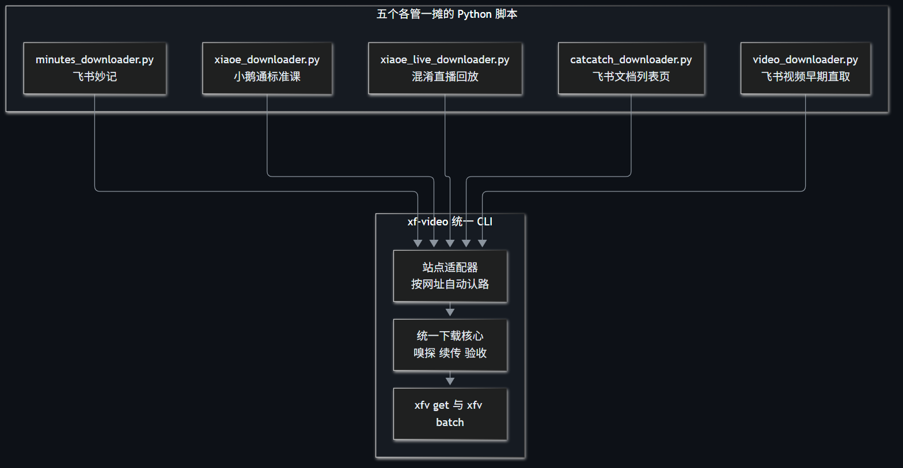
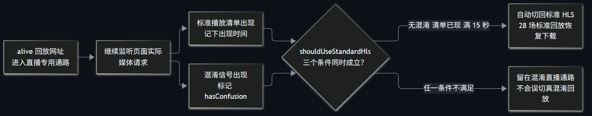

> A 系 AI 工作流第 10 篇。[A07](/post/206.html) 复盘了 `xf-video` 的三个版本怎样被真实故障推着往前走，这篇把版本故事放下，只讲日常使用：环境预检、登录、单条下载、JSON 批量、断点重跑和文件验收。

视频下载最容易出现一种假轻松：命令终于跑起来了，终端却不说话；等了一个小时，既不敢停，也不知道文件能不能播。`xf-video@0.1.2` 把下载过程拆成可观察的几段，但使用前仍需把链接、登录态和输出目录准备好。

这篇只写本人已经获得访问权限的内容。工具不处理 DRM、验证码、付费权限或平台风控绕过。

## 一、先让 `doctor` 把环境问题筛掉

运行环境是 Windows 10/11、Node.js 22 或更高版本、本机 Microsoft Edge，以及已经加入 PATH 的 FFmpeg 和 FFprobe。

安装前可以先检查：

```bash
node --version
ffmpeg -version
ffprobe -version
```

全局安装固定版本：

```bash
npm install -g xf-video@0.1.2
xfv --version
xfv doctor
```

不想全局安装，可以显式指定包名、版本和命令：

```bash
npx --yes --package xf-video@0.1.2 xfv doctor
```

`xf-video` 和 `xfv` 是等价命令，下面统一使用 `xfv`。

`doctor` 会检查六项：Node.js 版本、FFmpeg、FFprobe、用户数据目录、默认输出目录和 Edge 启动。它还会实际创建临时浏览器 profile 做一次预检，因此不是只打印几条静态配置。

指定将来的下载目录一起检查：

```bash
xfv doctor --output-dir 'F:/course-archive'
```

任何一项失败，都先修环境再登录。尤其是 FFmpeg 与 FFprobe，它们不仅负责封装视频，还负责最后的时长读取和整段解码验收。

## 二、登录保存的是独立浏览器 profile

第一次使用时，把一个本人可以正常访问的课程或视频页面传给 `login`：

```bash
xfv login '<课程页面链接>' --profile default
```

Edge 弹出后，由本人扫码或完成登录。随后有两种收尾方式：

- 回到终端按 Enter，工具关闭浏览器并保存 profile；
- 直接关闭本次打开的浏览器，持久目录同样会保留。

默认 profile 位于用户目录下的 `.xf-video/profiles/default`。后续下载要继续使用同一个名称：

```bash
xfv get '<视频页面链接>' --profile default
```

需要区分不同账号或不同课程环境时，可以使用另一个名称：

```bash
xfv login '<课程页面链接>' --profile course-a
xfv get '<视频页面链接>' --profile course-a
```

profile 名称只能包含字母、数字、点、下划线和连字符。`--profile` 与 `--profile-dir` 不能同时使用，前者使用工具管理的命名目录，后者直接接收已有浏览器目录：

```bash
xfv get '<视频页面链接>' --profile-dir 'F:/browser-profiles/course-a'
```

不要把日常正在使用的浏览器目录交给多个进程同时占用，也不要把 profile 目录提交到 Git 或发给别人。里面保存的是登录态，不是普通配置。



## 三、单条下载先跑通，再考虑批量

最简单的用法：

```bash
xfv get '<视频页面链接>'
```

默认输出到当前工作目录下的 `downloads/`，文件名由识别到的标题生成。建议显式指定目录，减少“文件到底落在哪个终端目录”的疑问：

```bash
xfv get '<视频页面链接>' --output-dir 'F:/course-archive'
```

单个任务也可以直接给出完整文件名：

```bash
xfv get '<视频页面链接>' -o 'F:/course-archive/001-课程名称.mp4'
```

`-o` 必须以 `.mp4` 结尾，并且不能和 `--output-dir` 同时使用。两种写法的分工是：

| 需求 | 使用参数 | 文件名由谁决定 |
|---|---|---|
| 下载一条，目录统一 | `--output-dir` | 页面标题或适配器结果 |
| 下载一条，名字也固定 | `-o` | 命令行指定 |
| 批量下载 | `--output-dir` 配合清单中的 `name` | 每条任务的 `name` |

### 自动识别和手动指定站点

`--site` 默认是 `auto`，只自动识别已经明确接入的域名。识别不了时会直接报参数错误，不会随便猜一个站点继续跑。

已验收的主要写法是：

```bash
# 小鹅通标准课
xfv get '<课程页面链接>' --site xiaoe --output-dir './downloads'

# 小鹅通直播回放
xfv get '<回放页面链接>' --site xiaoe-live --output-dir './downloads'

# 飞书视频或妙记页面
xfv get '<视频页面链接>' --site feishu --output-dir './downloads'
```

大多数情况下不需要手动指定。只有自动识别无法覆盖明确已知域名时，才用 `--site` 告诉适配器该走哪条路。

`/v4/course/alive/` 回放默认进入直播适配器。`0.1.2` 会观察页面实际发出的媒体请求：标准 m3u8 出现时按条件回退标准嗅探，带 `confusion_index` 的混淆回放仍走解混淆路径。



标准 HLS 回退要求三个条件同时成立：没有混淆信号、标准清单已出现、15 秒宽限期已满。这个 15 秒是当前实现的等待预算，不是平台协议承诺。

飞书文档列表页的卡片跳转和序号通路仍等待真实端到端验收，这篇不把它列成已经验证的日常用法。

## 四、下载过程中，终端应该出现什么

MP4 直取会报告已下载字节数；HLS 下载和整段解码期间，FFmpeg 通过 `-progress` 默认每 5 秒报告已处理时长和速度。

典型过程可以理解为：

1. 识别站点和页面；
2. 启动播放并嗅探真实媒体请求；
3. MP4 分段下载，或 HLS 清单、key、MAP 和分片下载；
4. 先写入 `.part.mp4`；
5. 用 FFprobe 读取媒体信息，再用 FFmpeg 整段解码；
6. 验收通过后发布正式 `.mp4`，清理半成品和续传元数据。

进度只报告已经处理的时长和速度，不预测剩余时间。长视频进入 FFprobe 或整段解码阶段时会另有提示，避免文件已经下完、终端却像僵死一样没有输出。

下载、整段解码等长步骤的默认等待预算是 7200 秒，也可以按秒修改：

```bash
xfv get '<视频页面链接>' --timeout 10800 --output-dir './downloads'
```

这个预算不是下载速度保证，也不是所有阶段共享的一个总倒计时，而是防止异常长步骤无限占用进程。正常的大文件仍应预留足够的磁盘和时间。

## 五、JSON 批量：每条任务必须有名字

单条验证成功后，再写 `jobs.json`。下面是最小示例，链接需要替换为本人有权访问的真实地址：

```json
[
  {
    "url": "<课程页面链接1>",
    "site": "xiaoe",
    "name": "001-示例课程"
  },
  {
    "url": "<课程页面链接2>",
    "site": "xiaoe",
    "name": "002-示例课程"
  },
  {
    "url": "<飞书视频链接>",
    "site": "feishu",
    "name": "003-示例回放"
  }
]
```

`batch` 中每一项都必须提供 `name`，工具会自动补上 `.mp4`。`name` 只是文件名，不要在里面再套目录。Windows 文件名中的非法字符会被清理，长度也有限制，但最好在一开始就使用稳定、可排序的名称。

先跑第一条做冒烟测试：

```bash
xfv batch jobs.json --offset 0 --limit 1 \
  --output-dir 'F:/course-archive' --profile default
```

确认第一条能播放后，再跑后续两条：

```bash
xfv batch jobs.json --offset 1 --limit 2 \
  --output-dir 'F:/course-archive' --profile default
```

`--offset` 从 0 开始，表示先跳过多少项；`--limit` 表示切片后最多执行多少项。省略时从第一项开始，默认上限是清单长度。

完整执行：

```bash
xfv batch jobs.json --output-dir 'F:/course-archive' --profile default
```

任务串行执行。单项失败会打印原因、计入最后的非零退出码，不会因为一条失败就抹掉其他条目的结果。末尾汇总会分别给出成功、跳过和失败数量。

清单使用严格字段校验，不要随手加入备注、标题别名或自定义输出字段。未知的 `site`、空的 `name`、非法 URL 都会在下载前被拒绝。

## 六、中断以后怎样重跑，不覆盖也不硬续

重跑前先理解三种文件：

| 文件 | 含义 | 重跑时怎样处理 |
|---|---|---|
| `name.mp4` | 已通过验收的正式文件 | 再次验收，有效则跳过 |
| `name.part.mp4` | 尚未发布的下载半成品 | MP4 按响应和校验器决定追加或重下 |
| `name.part.json` | MP4 续传校验信息 | 只保存 ETag 或 Last-Modified，不保存签名 URL |

MP4 只有服务器返回与当前文件匹配的 `206 Content-Range` 时才追加。服务器返回 `200`，或者旧半成品缺少安全校验器，工具会从头下载，避免把两段不同内容拼在一起。

飞书妙记的真实样本支持 Range，但不返回 ETag 或 Last-Modified，因此该通路的安全策略是全量重下。带校验器的 206 追加由本地自动化覆盖。HLS 当前不支持断点续传。

正式文件采用不覆盖发布：优先通过硬链接原子发布，文件系统不支持时退化为排他复制，并检查跨盘复制前后的大小。已经存在且有效的文件会跳过；已经存在但损坏的文件不会被静默覆盖，该条会报错。批量中会计入失败并继续后续条目，最后退出码为 1。

这时应先保留现场，把损坏文件改名或移到隔离目录，再重跑。不要为了省事直接删除唯一一份可能可修复的素材。

同一个输出路径的冲突预留目前只在单个进程内有效。不要同时启动两个 `xfv` 进程写同一目录，跨进程 lockfile 尚未实现。

## 七、哪些通路已有真实样本，哪些还不能打包票

| 通路 | 当前验收状态 |
|---|---|
| 飞书妙记 MP4 | 授权样本完成端到端验收，覆盖原生嗅探、断流保留、重试、FFprobe 和整段解码 |
| 小鹅通标准课 | 授权样本完成 HLS AES-128、key 与分片鉴权、FFprobe 和整段解码验收 |
| 小鹅通 alive 标准 HLS 回放 | 28 场授权回放恢复下载，49.06 分钟样本整段解码通过 |
| 小鹅通 confusion 混淆回放 | 固定向量测试与一次旧样本验证，第二个授权样本待补 |
| 通用 HLS/AES | 本地动态清单覆盖鉴权、相对 key/MAP、跨域凭证隔离和错误路径，真实飞书 HLS 样本待补 |
| 飞书文档列表页跳转 | 逻辑已接入，真实列表端到端验收待补 |

“待补”不等于一定不能用，但不应该把它写进无人值守生产流程，再默认所有页面都会成功。

工具也不做全站课程发现、并发下载、HLS 续传、清晰度选择或 B 站下载。链接清单仍需从本人有权访问的页面整理。

## 八、常见故障按提示分类处理

| 现象或提示 | 更可能的原因 | 处理方式 |
|---|---|---|
| `doctor` 找不到 FFmpeg/FFprobe | PATH 未配置或终端未重开 | 安装后重开终端，或用参数、环境变量指定路径 |
| Edge 无法启动、profile 被占用 | 同一 profile 已被另一个实例使用 | 关闭对应实例，或换独立 profile |
| 页面跳商品详情、出现“前往购买” | 当前账号无权限或登录态过期 | 本人重新登录或获得权限，不继续嗅探 |
| 一直等不到混淆信号 | alive 页面实际可能是标准 HLS | 确认版本为 0.1.2，再保留日志排查 |
| 长时间没有任何进度 | 旧版本缺少进度输出，或任务异常 | 先核对版本和当前阶段，不要立刻强杀 |
| 重跑仍然从头下载 MP4 | 服务端没有提供安全续传校验器 | 接受安全重下，不手工拼接半成品 |
| 正式文件存在但未通过验收 | 旧文件损坏或不完整 | 先隔离旧文件，再重跑 |
| 无法识别站点 | 域名不在自动识别范围 | 明确知道类型时使用 `--site` |

工具路径也可以用参数或环境变量覆盖：

| 用途 | 命令行参数 | 环境变量 |
|---|---|---|
| Edge 路径 | `--edge` | `XF_VIDEO_EDGE` |
| FFmpeg 路径 | `--ffmpeg` | `XF_VIDEO_FFMPEG` |
| FFprobe 路径 | `--ffprobe` | `XF_VIDEO_FFPROBE` |
| 数据目录 | 无 | `XF_VIDEO_HOME` |
| 临时预检目录 | 无 | `XF_VIDEO_TEMP` |

例如：

```bash
xfv doctor --edge 'C:/Program Files (x86)/Microsoft/Edge/Application/msedge.exe' \
  --ffmpeg 'D:/tools/ffmpeg/bin/ffmpeg.exe' \
  --ffprobe 'D:/tools/ffmpeg/bin/ffprobe.exe'
```

## 九、最后仍要自己抽查文件

工具发布正式 MP4 前已经做过 FFprobe 和整段解码，但批量归档仍建议保留一次人工抽查。

查看时长与字节数：

```bash
ffprobe -v error -show_entries format=duration,size \
  -of json 'F:/course-archive/001-示例课程.mp4'
```

单独再做一次完整解码：

```bash
ffmpeg -v error -i 'F:/course-archive/001-示例课程.mp4' -f null -
```

没有错误输出只是媒体层验收的一部分。还要抽查开头、中段和结尾画面，确认不是黑屏、错课、只有音频或内容被截断。

退出码可以作为自动化依据：成功为 0，运行或下载失败为 1，参数错误为 2，SIGINT 中断为 130。批量命令只要存在失败项，最后就返回 1。

## 十、签名地址和登录态不该出现在归档里

HLS 下载通过只监听 `127.0.0.1` 随机端口的本机代理转发。FFmpeg 接收的是带随机令牌的本机地址，真实签名 URL 保存在进程内存映射中，日志会清理媒体签名、鉴权头和本机代理令牌。

这套设计保护的是本机传参和日志边界，不等于匿名，也不改变服务端权限。以下目录仍属于敏感数据：

- `.xf-video/profiles/` 中的登录态；
- 下载输出的课程视频；
- 可能包含私有标题或页面信息的本地清单；
- 排障时另行保存的原始日志。

公开文章和 issue 只保留占位链接，不把真实课程 URL、Cookie、媒体签名或 profile 贴进去。

项目地址：

- npm：[xf-video](https://www.npmjs.com/package/xf-video)
- GitHub：[xf-video](https://github.com/yeyangchen2009/xf-video)
- 故障复盘：[A07](/post/206.html)
