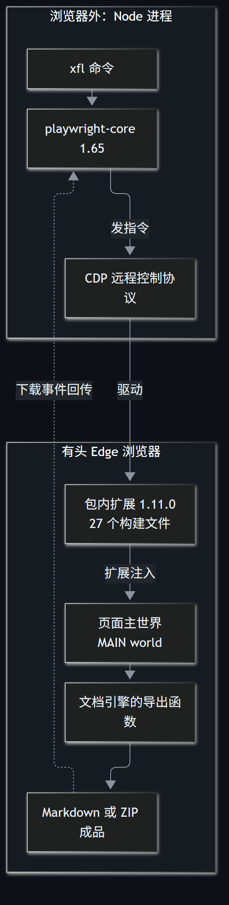
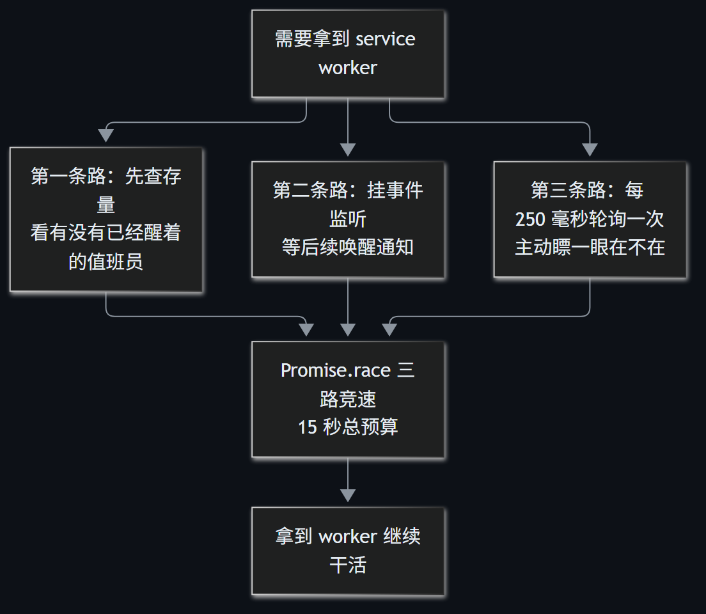

> A 系 AI 工作流第 11 篇。[A08](/post/207.html) 讲的是 `xf-lark` 怎样给浏览器下载链路补上看门狗，这篇专注日常使用：单篇、多篇、Markdown 清单、JSON 清单、月份过滤、失败重跑和报告验收。

`xf-lark@0.1.1` 可以把本人已有权限的飞书云文档下载成 Markdown。图片较多的文档通常会得到 ZIP，里面同时保存 Markdown 和素材；它不是一个把任意网页转成 Markdown 的通用爬虫，也不是绕开文档权限的接口。

工具依靠包内固定版本的 Cloud Document Converter 扩展完成转换，运行时会打开有头 Edge。看到浏览器弹窗不是异常，恰恰是正常工作环境。

## 一、安装后先预检，不急着登录

运行前提是 Windows 10/11、Node.js 22 或更高版本、本机 Microsoft Edge。FFmpeg 不参与这个工具，文档 ZIP 也不需要额外安装解压软件才能下载。

```bash
node --version
npm install -g xf-lark@0.1.1
xfl --version
xfl doctor
```

免全局安装时，包名、版本和短命令都要写全：

```bash
npx --yes --package xf-lark@0.1.1 xfl doctor
```

`xf-lark` 和 `xfl` 等价，下面统一写 `xfl`。

`doctor` 检查 Node.js、包内扩展资产、有头 Edge 加载、目录可写和临时目录等硬性条件，同时软提示登录态是否可用。尚未登录时出现“未发现可用登录态”只是提醒，不代表环境预检失败。

输出目录也可以一起检查：

```bash
xfl doctor --output-dir 'F:/doc-archive'
```

如果 Edge 安装在非标准位置：

```bash
xfl doctor --edge 'C:/Program Files (x86)/Microsoft/Edge/Application/msedge.exe'
```



## 二、登录要按 Enter 保存，别提前关窗口

把当前工具支持的完整飞书文档链接传给 `login`：

```bash
xfl login '<飞书文档链接>'
```

这里的占位符要换成浏览器打开文档时地址栏里的完整地址，不是随便一个飞书首页或普通网页。公开示例不写真实文档 token。

Edge 弹出后，由本人完成登录，然后**回到终端按 Enter**。工具此时才会读取浏览器状态并落盘。登录窗口用于完成站点登录，不保证直接落在传入的具体文档页。与 `xf-video` 不同，直接提前关闭 `xf-lark` 的登录窗口会按“登录态未保存”报错，需要重新执行。

默认登录态保存到：

```text
%USERPROFILE%/.xf-lark/storage/default.json
```

终端只报告 Cookie 数量和 localStorage 键数量，不打印具体值。登录态按 bearer token 级敏感数据管理，目录和文件会设置受限权限，但 Windows 上还要结合实际 ACL 理解，不要把 mode 数字当成全部安全边界。

使用命名 profile 区分账号：

```bash
xfl login '<飞书文档链接>' --profile work
xfl get '<飞书文档链接>' --profile work
```

对应文件变为 `.xf-lark/storage/work.json`。下载时的 `--profile` 必须与登录时一致。

已有兼容登录态文件时，也可以显式传入：

```bash
xfl get '<飞书文档链接>' --storage 'F:/private-storage/doc-state.json'
```

工具兼容 Playwright storageState 和历史 Python 版的扁平 `{cookies, localStorage}` 格式，`login` 新写入的是原生格式。这个文件同样不进 Git、不上传、不贴入 issue。

## 三、单篇与多篇直传：先弄清输出目录

下载一篇：

```bash
xfl get '<飞书文档链接>'
```

默认落到当前工作目录下：

```text
downloads/direct/
```

一次传多篇，任务会串行执行：

```bash
xfl get '<飞书文档链接1>' '<飞书文档链接2>' \
  --output-dir 'F:/doc-archive'
```

指定月份目录：

```bash
xfl get '<飞书文档链接1>' '<飞书文档链接2>' \
  --month 202611 --output-dir 'F:/doc-archive'
```

这时输出进入：

```text
F:/doc-archive/202611/
```

单篇可以自定义文件名词干：

```bash
xfl get '<飞书文档链接>' \
  -o '飞书文档转换手册' --profile default
```

`-o` 只传词干，不写 `.zip` 或 `.md`，最终扩展名以浏览器实际产物为准。它只支持单个链接，也不能与 `--output-dir` 同时使用。多篇需要统一目录时用 `--output-dir`，需要稳定命名时用清单。

### 同名文件不一定代表同一篇文档

直传模式默认采用浏览器建议的文件名。不同链接如果产生同名文件，第二个会按 `<词干>_<行动营ID前8>` 改名，继续冲突再追加序号。

所以，直传重跑不等于按 URL 自动去重。需要利用既有文件跳过重复任务时，应使用带 `name` 的清单条目，让它进入稳定的命名与 SKIP 体系。

## 四、Markdown 清单：格式不是自由排版

手册总表可以直接沿用下面的结构：

```markdown
## 202611破局行动

### 示例手册一-1
- 行动手册: <飞书文档链接1>

### 示例手册二-2
- 行动手册: <飞书文档链接2>

## 202612破局行动

### 示例手册三-1
- 行动手册: <飞书文档链接3>
```

执行：

```bash
xfl batch handbook.md --output-dir 'F:/doc-archive'
```

这三行各有职责：

| 清单行 | 用途 | 缺少时会怎样 |
|---|---|---|
| `## YYYYMM破局行动` | 确定月份目录 | 链接出现在月份标题之前会带行号报错 |
| `### 名称-序号` | 确定条目标题与归属 | 链接缺少所属标题会带行号报错 |
| `- 行动手册: <链接>` | 提供实际文档地址 | 不符合支持格式的链接会被拒绝 |

这里不是“只要 Markdown 里有链接就能识别”。月份标题、条目标题和 `行动手册` 行组成一个严格的三正则状态机。把链接放到月份标题之前，旧 Python 版可能静默漏掉，当前版本会明确指出行号。

只处理某个月：

```bash
xfl batch handbook.md --month 202611 \
  --output-dir 'F:/doc-archive'
```

`--month` 也接受带连字符的写法，内部会去掉 `-`，但清单标题仍应保持 `YYYYMM` 六位月份格式。

## 五、JSON 清单：`name` 会改变条目语义

JSON 适合脚本生成和精确控制：

```json
[
  {
    "url": "<飞书文档链接1>"
  },
  {
    "url": "<飞书文档链接2>",
    "name": "手册二",
    "month": "202611"
  }
]
```

执行：

```bash
xfl batch jobs.json --output-dir 'F:/doc-archive'
```

顶层必须是数组，每项只接受 `url`、`name`、`month` 三个字段。多写一个 `title` 或 `note` 会直接报未知字段，不会悄悄忽略。

`name` 不是普通的显示备注：

| 条目形态 | 命名方式 | 默认目录 | 同名处理 |
|---|---|---|---|
| 不带 `name` | 跟随浏览器下载建议 | `downloads/direct/` | 碰撞时加 ID 或序号 |
| 带 `name` | 按指定名称命名 | 有 `month` 则进月份目录，否则进 `direct/` | 已有同名 `.zip` 或 `.md` 可 SKIP |

`month` 必须是 `YYYYMM` 六位月份。带 `name` 的 JSON 条目与 Markdown 清单条目采用同一套稳定命名逻辑，不再被误判为直传任务。

## 六、先过滤月份，再做 offset 和 limit

大批量运行前，先用一条任务验证清单和登录态：

```bash
xfl batch handbook.md --month 202611 --offset 0 --limit 1 \
  --output-dir 'F:/doc-archive' --profile default
```

再跑该月接下来的两条：

```bash
xfl batch handbook.md --month 202611 --offset 1 --limit 2 \
  --output-dir 'F:/doc-archive' --profile default
```

处理顺序是：

1. 读取并解析完整清单；
2. 如果传了 `--month`，先筛出对应月份；
3. 从筛选结果开头跳过 `offset` 项；
4. 最多保留 `limit` 项；
5. 串行执行剩余条目。

所以，`--offset 1` 指的是“月份过滤后的第二项”，不是原始文件的绝对第二行。过滤后没有条目会明确报错，不会生成一份看似成功的空报告。

## 七、重跑 SKIP 与失败继续，是两套机制

对于带名称的清单条目，输出目录中同名 `.zip` 或 `.md` 任一存在，任务就会跳过。文件名词干按 80 个 Unicode 码点截断，与旧 Python 版保持一致，老输出目录可以继续使用。

这带来两种典型结果：

- 上次成功的条目，这次显示 `SKIP`，不重复弹下载；
- 上次失败且没有正式产物的条目，这次重新执行。

单项失败会写入结果并继续后续条目，最后进程退出码为 1。不要因为命令继续往下跑，就把整批视为全部成功。

坏文件不会靠占位获得永久 SKIP。浏览器产物先写同目录 `.tmp-<pid>-N`，通过校验后才原子改名为正式文件：

| 产物 | 发布前检查 |
|---|---|
| ZIP | 检查 `PK` 文件头和 EOCD 尾部目录 |
| Markdown | 检查 fatal UTF-8 解码 |

下载、校验或改名失败时，临时文件会被清理。ZIP 的这项检查属于结构浅校验，不等于逐条 CRC 或全部素材内容审查；重要资料仍应实际打开抽查。

## 八、报告里的“成功”包含跳过

任务进入执行并完成汇总后，会在输出根目录写：

```text
xf-lark-report.md
```

报告包含：

- 任务总数；
- 成功数，其中包含正常下载和 SKIP；
- 失败列表及脱敏原因；
- 是否完整跑完，或是否被 SIGINT 中断。

终端末尾也会打印完成数和报告路径。参数、清单或登录态等前置失败可能直接退出，此时未必生成报告，应先看终端错误。验收时要把报告、控制台逐项 OK/FAIL 和实际文件三方对照，不能只看最后的进程退出码。

参数错误的退出码为 2，存在下载失败为 1，正常完成为 0，进程内 SIGINT 路径为 130。

Windows 控制台的真实 Ctrl+C 有一个平台限制：控制台可能在 Node.js 完成异步报告和深度清理前回收进程。因此，强中断后可能缺少最终报告，并残留一个空的 `xfl-profile-*` 目录，但 `.tmp` 原子落盘仍能避免半成品占用正式文件名。

每次启动会清扫同前缀、超过 1 小时未变动的旧 profile。正在运行的新目录和前缀之外的文件不在清扫范围内。

## 九、运行时为什么还要弹 Edge

扩展的后台逻辑要求窗口恰好有一个活动标签页才注入转换脚本，并且只有默认的 `legacyFileSave` 下载方式能被当前自动化链接捕获。

因此，每次下载运行都会创建全新的临时浏览器 profile：

- 不继承日常浏览器里可能冲突的扩展设置；
- 保持单标签页工作环境；
- 意外弹窗会被立即关闭；
- 正常运行结束后自动清理 profile。

有头模式是硬约束，不支持 headless。批量运行期间不要在这个专用窗口里手动开新标签、切换扩展设置或操作下载按钮，让命令自己串行推进。



扩展 service worker 的发现同时使用查存量、事件监听和 250 毫秒轮询，总等待预算 15 秒。导航和点击有 30 秒上限，关闭有 10 秒上限，避免某个浏览器调用没有回应时整批无限等待。

## 十、超时、权限与登录态分别怎样处理

单篇下载等待与落盘的默认预算是 300 秒。图片很多、文档很大时，可以提高：

```bash
xfl batch jobs.json --timeout 900 \
  --output-dir 'F:/doc-archive' --profile default
```

超时后会取消当前条目、记录失败并继续后续任务。它不是保证大文档一定能在 900 秒内完成，而是给异常等待一个可恢复的终点。

| 现象 | 优先判断 | 下一步 |
|---|---|---|
| 提示没有可用登录态 | 尚未登录或 `--profile` 不一致 | 用同一名称重新执行 `login` |
| 登录后仍无权限 | 当前账号没有文档访问权 | 本人获得权限，不尝试绕过 |
| 转换按钮一直不出现 | 页面形态、权限、扩展注入或标签页环境异常 | 保持单标签页，保留脱敏报错再排查 |
| 大文档落盘超时 | 默认 300 秒不够或浏览器无响应 | 先用 900 秒重试单条，仍失败则保留报告 |
| 重跑全部 SKIP | 同名正式文件已经存在 | 抽查文件是否完整，不要盲目删除重下 |
| 直传重跑出现新文件名 | 直传采用碰撞改名，不是 URL 去重 | 需要稳定重跑时改用带 `name` 的清单 |
| 强中断后有空 profile | Windows 控制台提前回收进程 | 留待下次启动按陈旧度自动清扫 |
| 过滤后没有条目 | 月份、offset 或 limit 组合为空 | 先核对月份筛选后的条目顺序 |

Edge、数据目录和临时目录也可以按环境调整：

| 用途 | 参数或环境变量 |
|---|---|
| Edge 可执行文件 | `--edge` 或 `XF_LARK_EDGE` |
| 数据根目录 | `XF_LARK_HOME` |
| 临时 profile 根目录 | `XF_LARK_TEMP` |
| 登录态文件 | `--storage` |
| 命名登录态 | `--profile` |

## 十一、下载完成以后，至少抽查这四项

1. 报告中的总数、成功数、跳过数和失败数与实际任务一致；
2. 月份目录、`direct` 目录和文件名词干符合清单语义；
3. ZIP 能正常打开，Markdown 能正常解码，图片素材可用；
4. 输出目录没有遗留 `.tmp-*`，失败条目的能力 URL 和鉴权参数仍保持脱敏。

当前已有三份真实大文档与 Python 版的 ZIP 条目级等价验收，也有重跑 SKIP、直传碰撞改名、无权限失败零残留和超时兜底记录。无图纯文本文档的真实端到端样本仍待补，严格 Markdown 解码分支目前由单元测试和本地仿造链路覆盖。

这套工具只负责把本人已有权限的文档可靠地取回来。文档内容、登录态和输出目录仍属于本地资料，公开报告或 issue 时不要附带真实能力链接。

项目地址：

- npm：[xf-lark](https://www.npmjs.com/package/xf-lark)
- GitHub：[xf-lark](https://github.com/yeyangchen2009/xf-lark)
- 浏览器链路复盘：[A08](/post/207.html)
